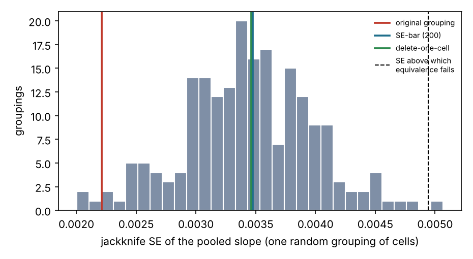
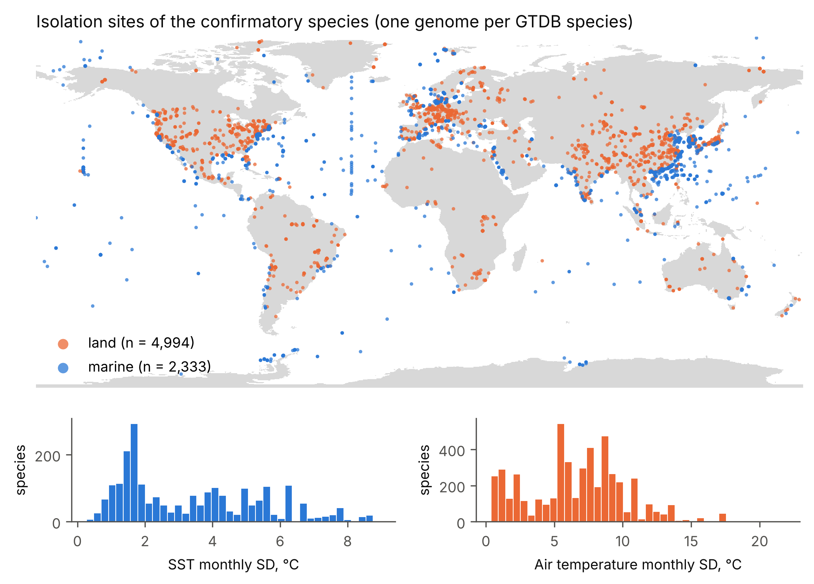
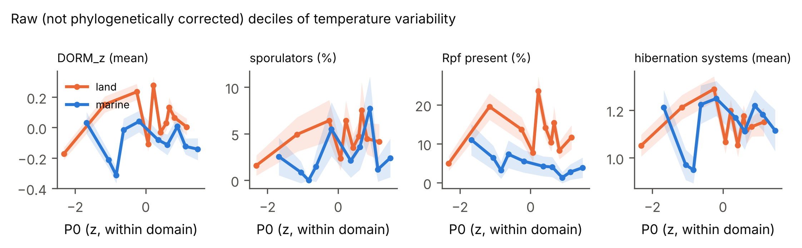
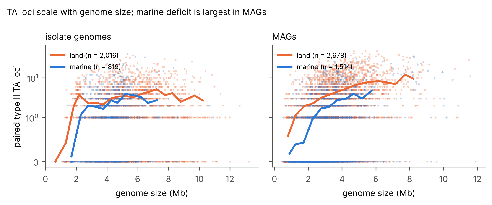

# Introduction

## Seed-bank theory and its comparative prediction
- **The phenomenon.** Most microbial cells in nature are inactive (Lennon & Jones 2011).
  Endospores, viable-but-non-culturable cells, persisters and cells with hibernating ribosomes
  together form a "seed bank".
- **What the seed bank does.** It buffers populations against unfavourable periods, maintains
  diversity (Jones & Lennon 2010) and alters evolutionary dynamics (Shoemaker & Lennon 2018).
- **The bet-hedging argument.** Spreading risk across active and inactive states raises long-term
  fitness when conditions vary unpredictably (Cohen 1966).
- **The comparative prediction.** Lineages living in more variable environments should carry more
  of the machinery for entering, maintaining and leaving dormancy.

## What has been tested so far
The prediction has been tested only indirectly:
- **Categorical genome comparisons:**
  - toxin–antitoxin (TA) content across lifestyle classes (Pandey & Gerdes 2005; Makarova et al.
    2009);
  - TA across open-ocean, coastal and freshwater picocyanobacteria (Fucich & Chen 2020);
  - sporulation across gut and environmental Firmicutes (Browne et al. 2021).
- **Community-level studies:** community-weighted dormancy traits related to succession (Kearns &
  Shade 2018), soil climate (Piton et al. 2023) and precipitation seasonality (Donhauser et al.
  2026).

None of these combined three features:
- a continuous, organism-independent measure of temporal variability at each genome's isolation
  site;
- phylogenetic regression;
- several dormancy mechanisms analysed in parallel.

## Three complications
1. **Genome size may lie on the causal path.** Seasonal or arid environments favour small
   genomes (Piton et al. 2023), and accessory gene families scale with genome size (Makarova et
   al. 2009; Fucich & Chen 2020). The total and direct effects of variability can therefore
   differ.
2. **TA modules are a poor dormancy proxy.** They are rapidly gained and lost and act largely in
   phage defence (LeRoux & Laub 2022). Their supposed control of persistence did not survive
   re-examination: the key paper was retracted (Maisonneuve et al. 2013, 2018), and deleting ten
   TA systems did not change persistence (Goormaghtigh et al. 2018; Harms et al. 2017).
3. **Bet-hedging concerns unpredictable variation.** Predictable seasonal cycles can be met by
   anticipation instead (Bernhardt et al. 2020). The two components should be separated (Colwell
   1974; Marshall & Burgess 2015).

## Aims
We pre-registered a test of the seed-bank prediction across 7,327 bacterial species with five
hypotheses:

| Hypothesis | Prediction |
|---|---|
| **H1 (primary)** | A dormancy composite increases with isolation-site temperature variability, as both a direct effect (adjusted for genome size) and a total effect. |
| **H1a–d** | Each mechanism follows the same pattern. |
| **H6** | Unpredictable variability predicts dormancy more strongly than seasonal variability. |
| **H3** | After genome-size correction, marine genomes are *not* TA-depleted. |
| **H5** | 16S rRNA copy number is positively associated with dormancy gene content (replicating Kearns & Shade 2018). |

# Methods

## Pre-registration
- **What was frozen.** Hypotheses, models, decision rules, the smallest effect size of interest
  (SESOI) and ten sensitivity analyses. They were frozen in a timestamped git commit
  (`prereg/PREREGISTRATION.md`, commit 9fae630, 17 Nov 2026 10:16 UTC) before any
  confirmatory model was fitted. The research repository is private.
  - The public release is a snapshot of the final analysis. It includes
    `provenance/prereg_freeze.txt`, which gives the freeze commit and a checksum showing that the
    plan file is unchanged.
  - The full git history is available to editors and reviewers on request.
- **What kind of pre-registration this is.** This is an internal, dated plan, not an entry in an
  independent registry such as OSF. Git timestamps are recorded by the author's own system.
  - The plan file did not change after the freeze, as the audit confirmed.
  - The full history, which shows the sequence of plan, data and analysis, is available on
    request.
  - The freeze time is not certified by a third party.
  Confirmatory genome download and annotation were running at the freeze, but no predictor was
  involved.
- **Pilot.** A held-out pilot of 400 species was used only to estimate the residual structure for
  a power simulation. The pilot species were excluded from all confirmatory tests.
- **Deviations.** All deviations and every exploratory analysis are listed in
  `results/deviations.md`.

## Genomes and isolation sites
**Genome pool.** From GTDB release R11-RS232 (Parks et al. 2022) we selected bacterial genomes with
all of:
- CheckM2 completeness ≥ 90 % and contamination < 5 %;
- parseable BioSample coordinates.

This gave 120,086 genomes from 33,581 species.

**Habitat classification.** Isolation sources were classified by ordered regular-expression rules.
Host-associated, engineered, hydrothermal, subsurface and hypersaline sources were excluded.

**Analysis domains:**
- **Marine:** marine surface water and sediment, within 50 km of a valid sea-surface-temperature
  cell.
- **Land:** soil and freshwater sites on a valid land-temperature cell.

**One genome per species.** We kept one genome per species, ranked by:
- completeness − 5 × contamination;
- with bonuses for isolate status and complete assemblies.

**Final set.** After the pre-registered QC (≥ 500 predicted proteins, ≥ 20 ribosomal-protein
genes), the confirmatory set held 7,327 species:
- 4,994 land and 2,333 marine;
- 2,835 isolate genomes and 4,492 metagenome-assembled genomes (MAGs);
- 81 phyla;
- 1,680 distinct 0.5° sites.

## Environmental variability
**Data.** Monthly series for 1991–2020:
- marine sites: NOAA OISST v2.1 sea-surface temperature (0.25°);
- land sites: GHCN_CAMS 2 m air temperature (0.5°).

**Metrics per site:**
- total SD;
- seasonal SD (the SD of the 12-month climatology);
- residual SD of de-seasonalised, de-trended anomalies;
- lag-1 autocorrelation of anomalies;
- Colwell's (1974) predictability, constancy and contingency;
- the seasonal fraction of variance.

**Primary predictor (P0).** log(total SD), standardised within each domain.

**What P0 measures.** At these sites the 12-month seasonal cycle accounts for a median of 94–95 %
of monthly temperature variance. P0 correlates r = 1.00 with seasonal SD in both domains, and only
r = 0.55–0.61 with the SD of annual means (interannual variability). P0 is therefore best read as
**the seasonal amplitude of temperature at the scale of the regional climate**. It is not a measure
of:
- unpredictable change;
- extremes;
- sub-monthly fluctuation, which monthly data cannot resolve;
- the microhabitat temperatures cells actually experience.

Soil, sediment and water buffer and delay air-temperature swings. We report interannual variability
and predictability indices separately (`results/variability_component_correlations.tsv`).

**Secondary predictors:**
- variability of ESA OC-CCI chlorophyll-a (marine);
- NOAA PREC/L precipitation (land);
- habitat niche breadth (Hao et al. 2026);
- genus-level social niche breadth.

## Dormancy gene detection
**Gene calling and search.**
- Genes were predicted uniformly with pyrodigal.
- They were searched with pyhmmer against a 174-model dictionary (Pfam, NCBIfam and KOfam
  models), using curated per-model cutoffs.

**Modules:**
- **Sporulation (SPO):** 33 scored core genes (Galperin et al. 2022), each protein assigned
  competitively to its best-scoring model. A genome is a "sporulator" if it has Spo0A and
  ≥ 25 of the 33 genes.
- **Resuscitation-promoting factors (RPF):** PF06737.
- **Ribosome hibernation (HIB):** long HPF, short HPF/RaiA, RMF, Balon and MRF.
- **Stringent response (SR):** long RSH, small alarmone synthetases (SAS) and small alarmone
  hydrolases (SAH).
- **TA:** paired type II toxin–antitoxin loci within three genes.
- **Mobile elements:** transposases and integrases.

**Primary composite (DORM_z).** The mean of the four z-scored log1p module counts. Its SD in the
confirmatory set is 0.57.

**What the composite represents.** The four modules capture different steps:
- forming a resistant state (sporulation);
- shutting down translation (hibernation);
- signalling starvation (stringent response);
- resuscitation (Rpf).

DORM_z is therefore a **dormancy-associated genomic repertoire**, not a measure of dormancy itself.
Every module was also tested separately (H1a–d) to check that no single module drives the result.

**Validation:**
- 14 reference genomes.
- An independent phenotype calibration on 543 Bacillota type strains (`validation/`). The dictionary
  and the pre-registered rule were fixed before these labels were assembled, so every genome is
  out-of-sample. Because related strains are not independent, we also report clade-aware estimates:
  - AUC 0.92; with a genus-clustered bootstrap over 270 genera, 95 % CI 0.88–0.95;
  - the pre-registered rule had sensitivity 0.90 (0.84–0.95) and specificity 0.78 (0.70–0.84);
  - no calls outside Bacillota;
  - leave-one-order-out: a threshold chosen on the other 12 orders (always ≥ 27 genes) classified
    the held-out order correctly 87 % of the time (weighted). The fixed pre-registered rule
    managed 82 %;
  - performance is weakest in Clostridiales (held-out accuracy 0.71) and Erysipelotrichales,
    where divergent sporulation genes are missed (`validation/clade_holdout.tsv`).
- Literature Rpf counts were matched exactly in 23 of 24 Actinomycetota.
- Genus-level checks on the full set:
  - 15 of 15 spore-forming genera were called sporulators, and 0 of 10 non-sporulating genera;
  - Spo0A was never called outside Bacillota.

**Growth rate.** Predicted maximal doubling time came from gRodon2 (Weissman et al. 2021).

## Statistical analysis
**Model families:**
- **Gaussian responses:** phylogenetic generalised least squares with Pagel's λ (phylolm), on the
  GTDB bac120 tree pruned to the analysis species.
- **Binary responses:** phylogenetic logistic regression (phyloglm, logistic_MPLE).

**Covariates:** domain, log genome size, completeness and MAG status. The total effect of H1
omitted genome size.

**Module tests:** controlled with Benjamini–Hochberg FDR within pre-defined families.

**Decision rule for H1:**
- **Supported:** β > 0, p < 0.05 and a 95 % CI that reaches +0.015.
- **Practically null:** a 95 % CI entirely within ±0.015.

**What the SESOI means biologically** (`results/sesoi_translation.tsv`).
- **On the composite.** A slope of 0.015 composite units per SD of P0 is 2.6 % of the SD of the
  dormancy composite.
- **Across the climate range.** From the 5th to the 95th percentile of sites (3.3 SD of P0) it
  corresponds to:
  - about 2–3.5 % more genes in each module, if all four modules shift together;
  - about 7–15 % more genes, if a single module carries the whole effect.
- **Against phylogeny.** Phylum means of the composite have an SD of 0.44, about 30 times the
  SESOI. This describes relative scale; it does not by itself establish the margin.
- **Judgement.** The equivalence margin was prespecified and translated into biologically
  interpretable changes in gene counts. Its biological relevance remains a stated scientific
  judgement, not an empirically established universal threshold.
- **Margin sensitivity.** We report equivalence at ±0.010 and ±0.020 alongside the confirmatory
  ±0.015 (`results/group_equivalence.tsv`). The confirmatory margin was not changed.

**Formal equivalence testing.** We also ran two one-sided tests (TOST; Schuirmann 1987; Lakens 2017)
against the bounds ±0.015.
- Equivalence at α = 0.05 means the 90 % CI lies inside the bounds.
- For MCMCglmm posteriors we used the stricter criterion that the 95 % HPD interval lies inside the
  bounds.
- Results are in `results/equivalence_tests.tsv`. Table 3 lists the target and the uncertainty
  method for every slope estimate.
- **Primary equivalence procedure (P)** (`scripts/26_tost_calibration.R`):
  1. Estimate Pagel's λ on the full data and fix it.
  2. Estimate the slope by phylogenetic GLS. This gives the same point estimate as phylolm.
  3. Estimate its SE by a delete-a-group jackknife over 20 random groups of 0.5° grid cells,
     refitting with λ fixed.
  4. Run TOST with a t distribution on 19 df.

  The 0.5° cell is the primary spatial unit. Larger blocks (1–5°) are robustness analyses of the same
  data, not independent confirmations.
- **Calibration of P.** P was applied unchanged to simulated data sets on the confirmatory tree,
  with the real P0 values. The data-generating model had Brownian error on the λ̂-transformed tree
  and site effects with the MCMCglmm-estimated SD. False-equivalence rate (Type I error), with
  Monte Carlo 95 % CIs:
  - at β = −0.015: 5.0 % (4.4–5.6 %) (5,000 replicates);
  - at β = +0.015: 4.5 % (3.9–5.1 %) (5,000 replicates).

  Probability of declaring equivalence:
  - at β = 0: 97.5 % (96.7–98.1 %; 2,000 replicates);
  - at β = 0.005: 83.8 % (81.4–86.0 %; 1,000 replicates);
  - at β = 0.010: 37.1 % (34.1–40.2 %; 1,000 replicates).

  Monte Carlo CIs are Clopper–Pearson. Results are in `results/tost_calibration_summary.tsv`.
- **How the 20 jackknife groups are built.** The deletion unit is a whole 0.5° grid cell: every
  species in a cell is removed together. The 1,642 occupied cells are assigned at random to 20
  groups of about 82 cells. The groups are therefore scattered across the globe, not geographically
  contiguous. The independence assumed is between 0.5° cells. Dependence between neighbouring cells
  is examined separately: with contiguous groups below, and with 1–5° blocks.
- **The SE from one grouping is itself noisy** (`scripts/30_grouping_sensitivity.R`,
  `results/grouping_sensitivity_summary.tsv`). On the real data, procedure P was repeated with 200
  random groupings, with 20 contiguous groupings, and with a delete-one-cell jackknife that has no
  grouping randomness at all:

  | Variant (pooled slope, real data) | SE | p_TOST | Equivalent at ±0.015 |
  |---|---|---|---|
  | Original grouping (seed 20261118), as first reported | 0.0022 | 0.0005 | yes |
  | 200 random groupings: median (5–95 %) | 0.0034 (0.0025–0.0043) | 0.011 (median) | 199 of 200 |
  | Delete-one-cell jackknife (1,642 cells) | 0.0035 | 0.007 | yes |
  | 20 contiguous groups (k-means on cell centroids), 20 seeds: median | 0.0035 | 0.012 (median) | 20 of 20 |
  | Original grouping, λ re-estimated in every replicate | 0.0023 | 0.0007 | yes |

  - The originally reported grouping gave the 4th-smallest SE of 200. Its p_TOST of 0.0005
    overstated the precision.
  - The typical real-data SE (0.0034–0.0035) equals the SD of the slope in the simulations
    (0.0035). Our earlier statement that the simulated data were noisier than the real data was
    wrong, and the power figures derived from it are withdrawn.
  - Fixing λ, rather than re-estimating it, changed the SE by less than 5 %.
- **Final procedure (P̄)** (`scripts/34_pbar_audit.py`).
  - **Notation.** Let b be the GLS slope of P0, with λ fixed at the full-data estimate. For a random
    assignment k of the C = 1,642 occupied cells to G = 20 groups:
    - b₍ₖ,g₎ is the slope with every species of group g removed;
    - b̄₍ₖ₎ is the mean of those 20 slopes;
    - Vₖ = (G − 1)/G · Σ_g (b₍ₖ,g₎ − b̄₍ₖ₎)² is the single-grouping jackknife variance.
  - **Definition.** P̄ averages *variances* over K independent assignments, then takes the root:
    SĒ = √( (1/K) Σₖ Vₖ ), with K = 200 on the real data.
  - **Decision.** Equivalence at margin M = 0.015 is declared if b − t₀.₉₅,₁₉·SĒ > −M and
    b + t₀.₉₅,₁₉·SĒ < M. p_TOST is the larger of the two one-sided t₁₉ p-values.
  - **Averaging SEs instead of variances** gives 0.00344 instead of 0.00348, and p_TOST 0.011
    instead of 0.012.
  - **Spread of the single-grouping SE** across the 200 assignments
    (`results/pbar_se_distribution.tsv`, Fig. S1): median 0.0034, 5–95 % range 0.0025–0.0043, full
    range 0.0020–0.0051, coefficient of variation 16 %.
  - **Status.** P̄ was adopted after seeing that the original assignment was unrepresentative. It
    is therefore **not** part of the pre-registration. The delete-one-cell and contiguous-group
    SEs are reported alongside.

  

- **Decision rule for equivalence.** Equivalence was concluded only when both procedures rejected
  both one-sided non-equivalence null hypotheses (β ≤ −0.015 and β ≥ +0.015):
  - the originally specified procedure P;
  - the subsequently adopted procedure P̄, which is not pre-registered.

  **Shared estimand.** P and P̄ test the same parameter: the same GLS slope of P0, from the same
  model, data and λ. They differ only in how its SE is estimated.
  - **Why the rule is valid.** If R_P and R_P̄ are the events that each procedure declares
    equivalence, the rule declares it on R_P ∩ R_P̄. Hence P(R_P ∩ R_P̄ | H₀) ≤ P(R_P | H₀).
    - The false-equivalence rate of the rule cannot exceed that of P, whatever led to P̄.
    - This bound requires only that P was fixed before its own result was seen, and that P is
      calibrated.
  - **Provenance of P** (`git log -- scripts/26_tost_calibration.R`).
    - P, including its seed (20261118, the analysis date), is in the first committed version of
      `scripts/26_tost_calibration.R`.
    - That script's single run on the real data wrote `results/tost_calibration_real.tsv` at
      15:12 UTC on 18 Nov 2026. Both were committed together in `f8b7719` (15:21 UTC), and the
      result file was never regenerated.
    - No other seed was run on the real data before the grouping-sensitivity analysis. Git records
      what was committed; it cannot prove that nothing else was run.
    - **P is pre-specified only in this limited sense.** It was designed after the confirmatory run, after
      the pooled point estimate and the model-based and 100-group SEs were known (17 Nov). It is
      not part of the pre-registration, which fixed the hypothesis, model, SESOI and decision rule,
      not the cluster-robust SE.
  - **Calibration of P**, per boundary, in the table below. Under the DGMs evaluated, the point
    estimates for P range from 3.6 % to 6.2 %. The guarantee therefore rests on how realistic
    those DGMs are.
  - **What P̄ does.** In the observed data, P̄ produced a larger SE and a less decisive result
    (p_TOST 0.012 vs 0.0005). This does not mean P̄ is more conservative in general.
  - **What this argument does not cover.**
    - The other estimators in the table were assembled during later checks, not fixed in
      advance.
    - They are not all calibrated: the model-based phylolm SE is known to be anti-conservative.
    - They do not all give a TOST p-value: for MCMCglmm, only whether the 95 % HPD lies within the
      margin.
    - They are therefore reported as **sensitivity analyses**, not as calibrated components of the
      decision.
  - **Sensitivity analyses.** Every estimator considered declares equivalence:
    - delete-one-cell;
    - contiguous groups;
    - two 100-group site jackknifes;
    - 0.5–5° block jackknifes;
    - the model-based SE;
    - MCMCglmm, by its HPD interval.

    The largest p_TOST among them is 0.015 (5° blocks).
  - **Randomness of single assignments.** Among the 200 single random assignments, one gave
    p_TOST = 0.054 (no equivalence). This randomness is what P̄ removes.
  - **Open question.** Whether the decision rule is appropriate is left for independent
    statistical review.
- **Calibration with λ re-estimated and with realistic clustering**
  (`scripts/31_calibration_lambda_free.R`, `scripts/31c_calibration_real_structure.R`). In every
  simulated data set, λ was re-estimated before the jackknife, exactly as on the real data. Three
  data-generating models (DGMs) were used:
  - **A.** The original DGM.
  - **B.** The variance components of the single phylogeny + site + residual model fitted to the
    real data (MCMCglmm), so that no component is counted twice.
  - **D.** The real residuals of the λ model, split into a phylogenetic part u and a
    non-phylogenetic part ε (best linear unbiased predictor).
    - The slope was set to the boundary, and the residuals were given independent random signs:
      per GTDB order (639 orders) for u, and per 0.5° cell for ε.
    - This keeps the real residual patterns within orders and within cells.
    - A first version that flipped whole residuals per cell destroyed the phylogenetic
      correlation between cells (λ̂ ≈ 0.04 instead of 0.94). It was stopped after 80 runs and is
      not used (`results/calibration_wild_cluster_naive_*`).

  **Variance structure, simulated vs real.**

  | Quantity | Real data | DGM B | DGM D |
  |---|---|---|---|
  | λ̂ | 0.94 | 0.93 | 0.97 |
  | SD of the slope estimate | — | 0.0035 | 0.0023 |
  | Mean jackknife SE (one grouping) | 0.0035 (median of 200 groupings) | 0.0037 | 0.0024 |
  | Between-cell share of residual variance | 0.50 (B's model form); 0.41 (D's) | 0.12 | 0.36 |

  - DGM B matches λ̂ and the size of the SE, but not the clustering of residuals within cells.
  - The real excess clustering lies in the phylogenetic part of the residuals (between-cell share
    0.45), not in the non-phylogenetic part (0.06; `results/calibration_real_structure_real_decomposition.tsv`).
    Co-located lineages share larger deviations than a uniform-rate Brownian model predicts.
  - DGM D reproduces most of that clustering.
  - In every DGM, the mean jackknife SE matched the SD of the slope.

  **False-equivalence rate at each boundary**, in %, with Clopper–Pearson Monte Carlo 95 % CIs
  (`results/pbar_calibration_by_boundary.tsv`). "Oracle SE" uses the simulation SD of the slope as
  the SE. It is the limit that averaging over many groupings approaches, and so it brackets the
  K = 200 used on the real data together with K = 1 and K = 5.

  | DGM | True β | Runs | P, one grouping | P̄, K = 5 | Oracle SE (limit of large K) |
  |---|---|---|---|---|---|
  | A, λ fixed (first calibration) | −0.015 | 5,000 | 5.0 (4.4–5.6) | — | 4.2 (3.6–4.8) |
  | A, λ fixed (first calibration) | +0.015 | 5,000 | 4.5 (3.9–5.1) | — | 4.1 (3.5–4.7) |
  | A, λ re-estimated | −0.015 | 500 | 3.6 (2.1–5.6) | — | 3.8 (2.3–5.9) |
  | A, λ re-estimated | +0.015 | 500 | 4.2 (2.6–6.3) | — | 4.4 (2.8–6.6) |
  | B, λ re-estimated | −0.015 | 500 | 5.6 (3.8–8.0) | 4.6 (2.9–6.8) | 4.4 (2.8–6.6) |
  | B, λ re-estimated | +0.015 | 500 | 6.2 (4.3–8.7) | 5.2 (3.4–7.5) | 5.2 (3.4–7.5) |
  | D, λ re-estimated | −0.015 | 500 | 4.8 (3.1–7.1) | 4.4 (2.8–6.6) | 4.6 (2.9–6.8) |
  | D, λ re-estimated | +0.015 | 500 | 3.6 (2.1–5.6) | 3.4 (2.0–5.4) | 4.0 (2.5–6.1) |

  - The estimated false-equivalence rates were broadly compatible with the nominal 5 % level
    across the data-generating mechanisms evaluated.
    - Monte Carlo uncertainty remains substantial: with 500 runs, an interval spans about ±2
      points. The table therefore shows no clear excess over 5 %, but it does not prove that the
      rate is at most 5 %.
    - Two intervals lie entirely below 5 % (DGM A with the oracle SE).
    - These intervals reflect simulation error only, not uncertainty in the real data.
  - The highest point estimate is 6.2 % (DGM B, one grouping, +0.015), which averaging reduces to
    5.2 %. Under the real-structure DGM D, the rates are 3.4–4.8 %.
  - The two boundaries differ by at most 1.2 percentage points, within Monte Carlo error.
  - Pooled over both boundaries, DGM D gives 4.2 % for P and 3.9 % for P̄.
- **What DGM D preserves and what it does not.** D treats the phylogenetic part of the residuals as
  exchangeable in sign between GTDB orders, and the non-phylogenetic part as exchangeable between
  cells.
  - **Preserved exactly:**
    - all covariances of u within an order, across cells too;
    - all covariances of ε within a cell;
    - the marginal size of every residual.
  - **Destroyed:**
    - covariances of u between orders, through deep branches;
    - covariances of ε between cells;
    - any asymmetry of the residual distribution, because random signs make it symmetric.
  - **Diagnostics on several metrics** (`scripts/33_structure_diagnostics.R`,
    `results/structure_diagnostics_summary.tsv`; 20 draws each, same model for all data sets):

  | Metric (residuals) | Real | DGM B, mean [range] | DGM D, mean [range] |
  |---|---|---|---|
  | λ̂ | 0.94 | 0.93 [0.93, 0.94] | 0.97 [0.97, 0.98] |
  | Between-cell share of variance | 0.41 | 0.11 [0.06, 0.22] | 0.36 [0.33, 0.38] |
  | Between-order share of variance | 0.73 | 0.66 [0.56, 0.76] | 0.84 [0.83, 0.84] |
  | Correlation of cell means, cells 0–1° apart | 0.16 | 0.10 [−0.04, 0.28] | 0.09 [0.02, 0.19] |
  | Correlation of cell means, cells 1–3° apart | 0.06 | 0.06 [0.00, 0.17] | 0.04 [0.00, 0.11] |
  | Correlation, same order, different cells | 0.73 | 0.65 [0.54, 0.76] | 0.84 [0.82, 0.84] |
  | Skewness | 0.88 | 0.01 [−0.24, 0.42] | 0.04 [−0.74, 0.84] |
  | Excess kurtosis | 1.0 | −0.06 [−0.56, 0.38] | 1.8 [1.4, 2.4] |

  - B and D bracket the real data on clustering within cells and within orders.
  - The real correlation between neighbouring cells lies inside both simulated ranges, but above
    both means. This is why contiguous groups and 1–5° blocks are reported, and they agree.
  - Neither DGM reproduces the skewness of the real residuals (see Limitations).
- **Why a calibrated procedure was needed.** An earlier simulation applied TOST with the model-based
  phylolm SE (`results/tost_power_simulation.tsv`, 200 replicates per value).
  - Probability of declaring equivalence at 0: 99.5 %; at 0.005: 95.5 %; at 0.010: 66 %.
  - At the boundaries it declared equivalence 9–9.5 % of the time (Monte Carlo SE about
    2 percentage points).
  - The cause is that the phylolm SE (about 0.0025) understates the sampling SD of the slope when
    site effects exist (0.0032–0.0037).

**Collection dates.** BioSample collection dates were retrieved from NCBI to check that samples fall
inside the 1991–2020 climate window (`scripts/23_collection_dates.py`).

**Power.** The simulated power on the confirmatory tree was 0.89 at β = 0.010 and about 1.0 at
β = 0.015.

**Exploratory analyses** (labelled as such throughout):
- genome-source moderation;
- site-blocked inference:
  - a jackknife over 100 groups of sites;
  - resampling with at most one or three species per site;
  - MCMCglmm with phylogenetic and site random effects;
- shared-family restriction;
- negative-control genes;
- variability re-parameterisation;
- follow-up tests of post-hoc explanations;
- an independent computational audit and re-analysis (`audit/`), including refits with
  nested-taxonomy and site random effects. This is a computational check, not a substitute for
  independent peer review;
- a within-species replication on 7,098 high-quality genomes from 1,473 species with ≥ 2 genomes
  (`replication_within_species/`). This used species fixed effects and site-clustered CIs, the
  dormancy-score and P0 standardisation of the main analysis, and completeness strata, plus a
  medium-quality extension (11,050 genomes).
  - **Scope limit, stated here because it governs every within-species result.** With species
    fixed effects, only species whose genomes differ in P0 inform a slope. That is 700 of the 1,473
    species, of which 238 inform the MAG slope.
  - Only 2 species vary in P0 within both MAGs and isolates. The within-species MAG × P0 term
    therefore mostly compares the within-species slopes of different species. It is not a direct
    MAG-vs-isolate comparison inside species (coverage table in Results).

Code, configuration files and outputs are in the repository.

# Results

## Dormancy gene content is phylogenetically conserved and barely responds to variability
**Variability range.** Temperature variability spanned an order of magnitude within each domain
(Fig. 1):
- marine median SD 3.0 °C;
- land median SD 6.9 °C.

**Phylogenetic signal.** All dormancy responses were strongly phylogenetically structured
(λ = 0.90–1.00; Table 1).

**H1, primary composite.** DORM_z increased with P0 by +0.0065 per SD (95 % CI 0.0016–0.0113,
p = 0.009; Fig. 2).
- **Size.** This equals 0.011 SD of the composite per SD of variability.
- **Decision.** The interval lies entirely within the pre-registered SESOI. Under the
  pre-registered rule we classify H1 as *practically null*. The slope is non-zero with the
  model-based SE, but not with the cluster-robust SE (two-sided p = 0.08).
- **Equivalence (decision rule: P and P̄ must both declare it).** Original P: p_TOST = 0.0005.
  Under P̄, the 90 % CI was 0.0004–0.0125 and p_TOST = 0.012: the
  pooled slope is equivalent to zero within ±0.015 (`results/genome_source_final_table.tsv`).
  - Delete-one-cell jackknife: p_TOST = 0.007.
  - 199 of 200 single random groupings declared equivalence.
  - The value first reported, p_TOST = 0.0005, came from one unusually favourable grouping (Methods).
- **Other implementations.** These agree, and their p-values differ only because they use different
  SE estimators:

  | Implementation | p_TOST |
  |---|---|
  | Model-based phylolm SE | 0.0003 |
  | Jackknife, G = 100 groups of 0.5° cells centred on rounded coordinates (`results/siteK1_cluster_robust.tsv`) | 0.012 |
  | Jackknife, G = 100 groups of grid-aligned 0.5° cells (`results/spatial_blocks_jackknife.tsv`) | 0.007 |
  | MCMCglmm phylogeny + site | 95 % HPD inside the bounds |
  | Within species | p_TOST = 0.0002 |

- **Margin sensitivity.** The pooled slope is equivalent at ±0.020 under every implementation. At
  ±0.010 it is equivalent only under MCMCglmm and within species, not under phylolm or either
  jackknife.
- **Reading.** We found no evidence that the pooled effect reaches the pre-specified smallest effect
  of interest. This is a statement about the pooled average; the genome-source-specific slopes are
  reported below.

**Interannual variability.** The SD of annual means, a distinct axis, did not predict DORM_z once
seasonal amplitude was in the model: +0.0029 [−0.0026, +0.0083], p = 0.30. It was also null within
each domain.

**H1-total.** The total effect was the same: +0.0057 [0.0007, 0.0106]; p_TOST = 0.0001.

**Collection dates** (`data_small/final/collection_dates.tsv`). Each genome maps to one BioSample:
7,714 unique BioSamples across the 7,715 analysis-table genomes, including the pilot.

**Retrieval** (`results/biosample_retrieval_flow.tsv`). The whole retrieval was re-run from scratch
without caches (`scripts/23c_biosample_reconstruct.py`). It gave the same raw date for all 7,714
BioSamples. `data_small/final/biosample_retrieval_log.tsv` traces every request to its final link.

| Step | Count |
|---|---|
| BioSamples requested | 7,714 |
| Step 1 (efetch by accession string): records returned | 7,708 |
| — matching a requested accession | 7,593 |
| — not requested (misresolved DDBJ/EBI digits read as a UID); discarded | 115 |
| Requests without their own record after step 1 | 121 |
| — a misresolved record came back instead | 115 |
| — nothing came back | 6 |
| Step 2 (esearch UID, then efetch) for all 121, i.e. the 115 + 6 above: record retrieved **and** its accession verified | 121 of 121 |
| **BioSamples linked to their genomes** (7,593 + 121) | **7,714** |
| **BioSamples not retrieved** | **0** |
| Confirmatory genomes whose record carries a usable collection date | 7,140 of 7,327 (97.4 %) |

- The 115 discarded records are not missing samples: they were never requested. Each is
  attributed to the request whose digits equal its UID (`data_small/final/biosample_discarded_returns.tsv`).
- A genome receives a date only from the record whose accession equals its own BioSample
  accession, so no discarded record could pass a date to any genome.
- Of the confirmatory genomes, 7,206 were linked in step 1 and 121 in step 2.
- The 6 requests that returned nothing in step 1 were all recovered in step 2. Five carry a date,
  and one has no collection_date field (`data_small/final/biosample_retrieval_log.tsv`).
- "Not retrieved" (0) is different from "no usable date" (187 confirmatory genomes: 171 with
  non-date text, 16 without the field).

**Status of the 7,327 confirmatory genomes:**

| Status | Genomes |
|---|---|
| Full date | 4,386 |
| Year-month | 1,663 |
| Year only | 1,084 |
| Range ("date1/date2"); none crosses a window boundary | 7 |
| Non-date text ("missing", "not collected", …) | 171 |
| No collection_date field | 16 |

7,140 genomes (97.4 %) are therefore dated, with median 2016 (interquartile range 2013–2018). A
genome was counted as in-window only if its whole stated period lay within 1991–2020. That applied
to 6,645 genomes: 90.7 % of all confirmatory genomes and 93.1 % of the dated ones. Restricting to
them left the key estimates unchanged:
- H1: +0.0044 [−0.0010, +0.0098];
- MAG × P0 interaction: +0.024;
- marine TA deficit: −0.24.

This shows that the conclusion does not depend on samples collected outside the climate reference
period. It does not show that the climate layer reflects the conditions the cells experienced.

**Genome-size path.** Variability did not predict genome size within a domain (+0.0004, p = 0.56).

**H1a–d, individual mechanisms.** None was significant after FDR control:
- sporulator probability within Bacillota (n = 394): logit +0.024, p = 0.80;
- sporulation gene count: −0.0037, q = 0.24;
- Rpf, all species: −0.0014, q = 0.24;
- Rpf within Actinomycetota (n = 1,029): −0.0053, q = 0.46;
- hibernation: +0.0051, q = 0.12;
- stringent response: +0.0049, q = 0.12.

**Pre-registered sensitivity analyses.** Every variant except the isolates-only analysis gave
slopes of +0.0046 to +0.0072. All of their CIs lie inside the SESOI except marine only, whose upper
limit is +0.0155 ("inconclusive"). The variants covered:
- species-median environment;
- completeness ≥ 95 %;
- marine only and land only;
- excluding Bacillota and CPR;
- adding growth rate, mobile elements or mean temperature as covariates;
- the summed composite (log1p scale, where the SESOI does not apply).

The exception was the isolates-only analysis, where the sign reversed: −0.0079 [−0.0151, −0.0008].

**MCMCglmm Poisson models (pre-registered sensitivity analysis 10)**, on GTDB branch lengths. Slopes
on the log-rate scale:
- Rpf: −0.004 [−0.035, +0.023];
- hibernation: +0.017 [+0.003, +0.031];
- stringent response: +0.010 [+0.000, +0.021].

The sporulation module was not included in this analysis.

**Secondary predictors:**
- chlorophyll variability: null;
- habitat niche breadth: null;
- social niche breadth: null;
- precipitation variability on land: +0.0078 [0.0016, 0.014], also inside the SESOI.

## Predictable and unpredictable variability cannot be separated in surface climate
**H6 tests.**
- Seasonal and residual SD gave nearly identical slopes: +0.0066 and +0.0061.
- In a joint model their difference was −0.002 ± 0.008 (p = 0.76).
- The two predictors were correlated (r = 0.82).
- No Colwell index survived FDR control.

**Re-parameterised models.** We modelled log total SD, the seasonal fraction of variance and the
anomaly autocorrelation together (Marshall & Burgess 2015). The seasonal fraction (+0.0009,
p = 0.84) and the autocorrelation (+0.0012, p = 0.68) added nothing beyond total SD.

**Land.** Total and seasonal SD were collinear (r = 1.00), so the decomposition cannot be
identified.

**Ocean.** Residual and seasonal variance were separable, but neither component was significant:
- residual: +0.006, p = 0.34;
- seasonal: +0.003, p = 0.63.

## Marine genomes are depleted in toxin–antitoxin loci (H3 rejected)
**H3 test.**
- Marine genomes carried 21 % fewer paired type II TA loci than land genomes of equal size
  (−0.231 log1p units [−0.281, −0.181], p = 2 × 10⁻¹⁹).
- This rejects H3, which predicted no deficit.

**Robustness of the deficit.** It was unchanged after controlling for:
- mobile-element load: −0.224;
- assembly N50 and contamination: −0.228;
- excluding genomes with plasmid-borne TA loci: −0.232.

The pilot, which was analysed before the freeze, had shown the same deficit (−0.27). It was the
discovery sample for this effect, and the confirmatory set replicated it.

**By genome quality.** The deficit shrank as genome quality rose (`results/review_models.tsv`,
`results/ta_review_models.tsv`):

| Genome set | Estimate (log1p units) | Fewer TA loci | p |
|---|---|---|---|
| All genomes | −0.231 | 21 % | 2 × 10⁻¹⁹ |
| Completeness ≥ 95 % | −0.188 | 17 % | 6 × 10⁻¹¹ |
| Completeness ≥ 98 % | −0.161 | 15 % | 1 × 10⁻⁶ |
| Completeness ≥ 98 %, contamination < 1 %, N50 as covariate | −0.111 | 10 % | 0.003 |
| Complete isolate genomes | −0.155 | 14 % | 0.03 |
| High-quality (≥ 98 %, < 1 %) MAGs | −0.299 | 26 % | 2 × 10⁻⁶ |
| High-quality (≥ 98 %, < 1 %) isolates | −0.040 | 4 % | 0.37 |

- **The tiers differ.** The difference between tiers was tested directly, not inferred from
  separate p-values:
  - marine × high-quality interaction: +0.141, p = 1 × 10⁻⁴;
  - marine × MAG interaction: −0.296, p = 1 × 10⁻¹².
- **Not a pairing artefact.** In high-quality genomes, single toxin genes, single antitoxin genes and
  orphan toxins all showed the same deficit as complete pairs (−0.108 to −0.121). Missing one
  partner of a pair through fragmentation therefore does not explain it.
- **Interpretation.** The deficit is concentrated in MAG-represented lineages. This design cannot
  tell whether it reflects never-cultured marine lineages or under-recovery of genomic islands in
  MAGs. Among cultured isolates the evidence for a marine deficit is weak: −4 % to −14 % depending on
  the subset, and significant only for complete genomes.

**By genome type** (Fig. 4):
- MAGs: −0.33, p = 7 × 10⁻²⁶;
- all isolates: −0.016, p = 0.70;
- complete isolate genomes: −0.155, p = 0.03.

**TA and variability.** TA content rose modestly with variability once mobile elements were
controlled (+0.021, p = 0.007).

**Streamlined marine clades (H4).** Pelagibacterales, *Prochlorococcus*, Actinomarinales and SAR86
did not carry fewer dormancy genes than genome size predicts (p = 0.29).

**H5 (16S copy number).** The replication failed: +0.035, p = 0.068.

## Exploratory: opposite slopes in MAGs and isolates
**Slopes by genome source, with equivalence tests** (`results/group_equivalence.tsv`). DORM_z per SD
of P0.

| Group | Method | Estimate | 90 % CI | 95 % CI | Equivalent at ±0.015? |
|---|---|---|---|---|---|
| MAG-represented species | phylolm, model SE | +0.018 | [0.012, 0.024] | [0.011, 0.025] | no |
| MAG-represented species | **P̄** (final: 20 groups, variance averaged over 200 groupings, t₁₉) | +0.017 | [0.006, 0.028] | [0.004, 0.031] | no |
| MAG-represented species | jackknife (100 groups) | +0.018 | [0.008, 0.028] | [0.006, 0.030] | no |
| MAG-represented species | MCMCglmm, phylogeny + site | +0.022 | — | [0.012, 0.032] | no |
| Isolate-represented species | phylolm, model SE | −0.008 | [−0.014, −0.002] | [−0.015, −0.001] | yes |
| Isolate-represented species | jackknife (100 groups) | −0.008 | [−0.015, −0.001] | [−0.016, +0.000] | yes |
| Isolate-represented species | **P̄** (final) | −0.009 | [−0.016, −0.002] | [−0.018, −0.000] | no |
| Isolate-represented species | MCMCglmm, phylogeny + site | −0.009 | — | [−0.017, −0.002] | no |
| Interaction (MAG − isolate slope) | phylolm | +0.024 | [0.016, 0.032] | [0.014, 0.034] | — |
| Interaction (MAG − isolate slope) | **P̄** (final; 50 groupings) | +0.024 | [0.012, 0.036] | [0.009, 0.039] | — |
| Interaction (MAG − isolate slope) | MCMCglmm | +0.026 | — | [0.015, 0.038] | — |
| Interaction, **within species** | species fixed effects | −0.011 | [−0.025, +0.003] | [−0.028, +0.005] | — |

- **MAG-represented species: a positive association, not a demonstrated effect above the SESOI.**
  Three claims must be kept apart.

  | Claim | Test (final procedure P̄) | Result |
  |---|---|---|
  | The slope differs from zero | two-sided t₁₉ | p = 0.013; 95 % CI [0.004, 0.031] |
  | The slope is above zero | one-sided, H₀: β ≤ 0 | p = 0.006 |
  | The slope is above the SESOI | one-sided, H₀: β ≤ 0.015 | p = 0.35 (delete-one-cell: 0.35; phylolm SE: 0.18) |

  The values given in an earlier draft (p = 0.005 two-sided, p = 0.003 one-sided, p = 0.33) came
  from the single original grouping and are superseded (`results/superseded_numbers.tsv`).

  - The point estimate exceeds the SESOI, but the data do not show that the true slope does.
  - The pre-registered H1 rule ("supported" if β > 0, p < 0.05 and the 95 % CI overlaps or exceeds
    the SESOI) would be met in this subgroup. That rule does not require the slope to exceed the
    SESOI, so it should not be read as showing a biologically important effect.
  - This subgroup analysis is exploratory.
- **Isolate-represented species.** Under P̄ the slope is −0.009, 90 % CI [−0.016, −0.002],
  p_TOST = 0.084 at ±0.015, and two-sided p = 0.049 against zero.
  - It is equivalent at ±0.015 under two of four methods, so it is inconclusive at the confirmatory
    margin.
  - It is equivalent at ±0.020 under all four.
- **The interaction.** The difference between groups was tested directly: as an interaction between
  species, and within species. Two separate intervals that each exclude zero would not show a
  difference by themselves.
- **Reading.** The two genome sources have opposite between-group slopes, which substantially
  attenuate the pooled estimate. The pooled slope is an average over the species we can sample, not
  a description of every lineage. We do not call this Simpson's paradox: that label requires
  conditions we have not established.

**A note on what "genome type" means here.** Genome type is confounded with lineage. Only 3 of
the 4,919 MAG-represented species also had an in-domain isolate genome. The selection rule
preferred isolates whenever a species had one. In practice the contrast is therefore between
**never-cultured** lineages (represented by MAGs) and **cultured** lineages (represented by isolates).

**The split.** The small pooled slope concealed opposite slopes in the two genome types (Fig. 5a):
- MAGs: +0.018 [0.011, 0.025], p = 1 × 10⁻⁷;
- isolates: −0.008 [−0.015, −0.001].
- Interaction: +0.024, p = 2 × 10⁻⁶.

**Adjustment for taxonomic and environmental composition**
(`scripts/28_interaction_composition.R`, `results/interaction_composition.tsv`).
- **Question.** MAG- and isolate-represented species differ in phylum, habitat, latitude and mean
  temperature. Is the interaction just a difference in composition?
- **Design.** Each composition variable entered as a main effect *and* as an interaction with P0, so
  the slope could differ by habitat, phylum, latitude and mean temperature. The MAG × P0 term is
  then the slope difference that remains. SEs come from both the phylolm model and P̄ (jackknife
  variance averaged over 50 random groupings).
- **Phylum.** The phyla with ≥ 20 species of each genome source were Pseudomonadota, Actinomycetota,
  Bacteroidota, Bacillota, Cyanobacteriota and Planctomycetota. The rest were pooled.
- **Common support.** This model used only the 18 phylum × habitat strata with ≥ 15 species of each
  source, with a separate slope per stratum.

| Model | n | MAG × P0 interaction | 95 % CI (model SE) | 95 % CI (P̄) | p (P̄) |
|---|---|---|---|---|---|
| Unadjusted | 7,327 | +0.024 | [0.014, 0.034] | [0.009, 0.039] | 0.003 |
| + habitat (and sediment) × P0 | 7,327 | +0.027 | [0.017, 0.037] | [0.015, 0.040] | 0.0002 |
| + phylum × P0 | 7,327 | +0.026 | [0.015, 0.037] | [0.010, 0.041] | 0.002 |
| + absolute latitude and mean temperature × P0 | 7,327 | +0.024 | [0.014, 0.034] | [0.008, 0.039] | 0.005 |
| All of the above | 7,327 | +0.028 | [0.016, 0.039] | [0.010, 0.045] | 0.004 |
| Common support, stratum × P0 | 7,147 | +0.025 | [0.013, 0.037] | [0.007, 0.043] | 0.008 |

- **These six models are robustness checks of one result, not six independent confirmations.**
  They use the same data and differ only in which composition terms are included.
- **Reading.** The interaction is not explained by the measured differences in phylum, broad
  habitat, latitude or mean temperature. Earlier analyses also restricted it to families containing
  both sources (below).
- **What this does not show.** It does not show that genome source *causes* the difference.
  Unmeasured differences can still produce it: finer habitat, sampling design, sequencing depth, or
  culturability itself. The within-species analysis, where the interaction was not detected,
  suggests that species composition may be a large part of the explanation.

**Domains.** The pattern held within each domain:
- MAGs: marine +0.024, land +0.013;
- isolates: marine −0.016, land −0.004.

**Robustness** (Table 2). The split survived every control:
- **Site clustering:** site-capped resampling (Fig. 5b) and leave-one-site-out deletion of the 15
  largest MAG sites (range +0.017 to +0.023).
- **Clade composition:** restriction to the 39 families that contain both genome types
  (interaction +0.023, p = 0.002).
- **Assembly quality:** N50 and contamination as covariates.
- **Habitat:** soil and sediment covariates.
- **Growth rate:** gRodon doubling time as a covariate.

**Gene recovery.** If high-variability MAG studies simply recovered more genes, near-universal genes
should also rise with P0. They did not:
- ribosomal-protein genes: −0.005. Ribosomal-protein genes are themselves prone to drop out of
  MAGs (Mise & Iwasaki 2022), so this control is imperfect;
- long RSH: +0.003, p = 0.12;
- coding density: null.

**Which genes carry it** (Fig. 6a):
- **Overall.** The reversal was carried by ribosome hibernation and, in MAGs, by small alarmone
  synthetases (SAS).
- **Hibernation copies.** It was strongest in paralogous copies of hibernation factors
  (`hib_extra`): +0.013 in MAGs (p = 2 × 10⁻⁵) against −0.011 in isolates (p = 0.0015).
- **Specific factors.** It was driven by short HPF/RaiA (MAGs +0.013, isolates −0.006) and Balon
  (MAGs +0.008).
- **Contamination.** It persisted in MAGs with < 1 % contamination (+0.017).
- **Near-complete, clean MAGs** (≥ 98 % completeness, < 1 % contamination, n = 906): the composite
  slope fell to +0.007 (p = 0.35), with a CI that still includes the full-set estimate.

**Coordinate precision.** This did not explain the isolate slope. The slope was more negative in
isolates with precise (≥ 3-decimal) coordinates (−0.010) than in those with coarse coordinates
(−0.001).

**Strain heterogeneity.** Three direct tests did not support the idea that MAGs are composite
population bins:
- CheckM strain heterogeneity *fell* with P0 in MAGs (p = 2 × 10⁻⁷).
- The MAG slope was as large in MAGs with zero strain heterogeneity (+0.024) as in heterogeneous
  MAGs (+0.013), and the interaction was null.
- In the ocean, hibernation paralogues were flat in MAGs (+0.002) but *fell* in isolates (−0.023).

The 92 single-amplified genomes (SAGs), which are single cells, were too few to inform (+0.002 ±
0.024). The pilot (n = 388) was too small to test the interaction (+0.013 ± 0.034).

## Exploratory: the reversal is not detected within species
**Design.** We annotated 7,098 high-quality genomes from 1,473 species that had ≥ 2 eligible genomes,
with 71 species carrying both genome types. We fitted species fixed effects with site-clustered
CIs (Fig. 7a).

**Actual scope of inference** (`replication_within_species/inference_scope_by_type.tsv`). With
species fixed effects, a slope is estimated only from P0 differences between genomes of the *same*
species. The informative part of the sample is much smaller than 7,098 genomes:

| Species type | Species | Genomes (MAG / isolate) | With any P0 variation | With P0 variation among MAGs | With P0 variation among isolates | With variation in both sources | Share of within-species P0 variation |
|---|---|---|---|---|---|---|---|
| MAG-only | 751 | 2,713 / 0 | 222 | 222 | 0 | 0 | 11 % |
| Isolate-only | 651 | 0 / 3,972 | 412 | 0 | 412 | 0 | 81 % |
| Both sources | 71 | 188 / 225 | 66 | 16 | 19 | 2 | 8 % |
| **All** | **1,473** | **2,901 / 4,197** | **700** | **238** | **431** | **2** | 100 % |

- **Limited leverage.** The within-species analysis can only weakly separate genome-source effects
  from compositional differences between species, because only two species vary in P0 within both
  genome-source categories. Not detecting an interaction within species therefore shows neither
  that the between-species interaction is compositional nor that it is a genome-source effect.
- **The within-species interaction is mostly not a same-species comparison.** It compares
  within-species slopes of MAG-only species with those of (other) isolate-only species. Only 2
  species allow MAG and isolate slopes to be compared inside one species.
- **The MAG side is thin.** Only 11 % of the within-species P0 variation comes from MAG genomes,
  which is why the MAG slope and the interaction have wide intervals.
- **Pooled.** The within-species slope of DORM_z on P0 was +0.001 [−0.006, +0.009], inside the
  SESOI. All model families gave −0.003 to +0.001.
- **Interaction.** The MAG × P0 interaction was −0.011 [−0.028, +0.005].
  - This interval excludes the between-species +0.024, at every completeness threshold (≥ 95 %:
    +0.005 [−0.007, +0.018]).
  - It does **not** show that there is no within-species interaction. The interval is wide and
    includes negative effects beyond the SESOI (p_TOST = 0.33 at ±0.015).
- **Isolates.** The isolate slope was +0.003 [−0.006, +0.011], excluding the between-species −0.008.
- **MAGs.** The MAG slope depended on completeness:
  - −0.008 [−0.023, +0.006] in all genomes;
  - +0.009 [−0.001, +0.019] at ≥ 95 %;
  - +0.005 at ≥ 98 %.
  The negative value in less complete MAGs comes from missing single-copy stringent-response genes:
  12 % of MAGs lack any long RSH gene, against 0.2 % of isolates.
- **Paired species.** In the 71 species with both types, the MAG − isolate gap did not scale with
  the P0 difference between their sites (+0.013 [−0.021, +0.048]; Fig. 7b).
- **Hibernation copies.** The one MAG-side signal that persisted was extra hibernation-factor copies.
  Their within-species MAG slope was positive at every completeness threshold (+0.006 to +0.017;
  between species +0.013) but not robust to correction across ten responses (q = 0.26).
- **Medium-quality extension.** Adding medium-quality genomes (11,050 genomes, 2,515 species) gave
  the same interaction result.
- **Control subset.** The species with several genomes carried the between-species interaction
  (+0.020 ± 0.029 on species means), so the within-species result is not a property of an unusual
  subset.

## Exploratory: site pseudoreplication makes the pooled estimate fragile
**Concentration of MAG sites.** The 4,492 MAGs came from 368 sites, and the ten largest hold 42 %
of them.

**Effect on the pooled estimate:**
- A site-grouped jackknife inflated the SE of the pooled slope 1.5-fold (p = 0.089).
- With one species per site, the pooled slope became slightly negative (median −0.005; 1 % of
  200 resamples positive).
- With up to three species per site, the median was −0.003.

**Effect within genome types.** The MAG and isolate slopes kept their signs under every
site-blocked scheme:
- MAGs: 99–100 % of resamples positive;
- isolates: 0 % positive.

**Spatial blocks (robustness).** The primary spatial unit is the 0.5° cell. We repeated the jackknife
with blocks of 1°, 2° and 5° (`results/spatial_blocks_*.tsv`). These are sensitivity analyses of the
same data, not independent confirmations.
- **Equivalence held at every block size:** TOST p = 0.007 (0.5°), 0.008 (1°), 0.005 (2°), 0.015 (5°).
- **One species per block** (100 resamples each), with the share of slopes inside ±0.015:
  - 0.5° sites (200 resamples, above): median −0.005, 100 % inside ±0.015;
  - 1° blocks: median −0.0026, 100 % inside ±0.015;
  - 2° blocks: median −0.0044, 99 % inside ±0.015;
  - 5° blocks: median +0.0044, 98 % inside ±0.015.
- **Genome-type split:** the 90 % CI of the MAG slope excluded zero at every scale, and so did the
  isolate slope's, in the opposite direction.

**Mixed model with phylogenetic and site random effects** (MCMCglmm on GTDB branch lengths).
- Pooled slope: +0.0039 [−0.0027, +0.0098] (pMCMC = 0.20). This is inside the SESOI.
- Interaction: +0.026 [+0.015, +0.038] (pMCMC = 0.001).
- MAGs: +0.022 [+0.012, +0.032].
- Isolates: −0.009 [−0.017, −0.002].

An independent refit with nested taxonomy and site random effects (lme4) agreed: pooled +0.0049
[−0.0015, +0.0114], interaction +0.028.

## Exploratory: Balon and cold seas
**The finding.** In marine isolates, the likelihood of carrying the recently described
hibernation factor Balon fell with mean sea-surface temperature (logit −0.34 per SD, p = 4 × 10⁻⁴;
Fig. 6b).
- **Not a smooth decline.** Across octiles of SST the prevalence was 17, 12, 10, 9, 4, 12, 5 and
  12 %.
- **By threshold.** Balon was present in 21 % of isolates below 5 °C (n = 80) and in 8 % above
  20 °C (n = 379).
- **Novelty.** Helena-Bueno et al. (2024) discovered Balon in a polar *Psychrobacter* but did not
  test temperature, so this association is new.

**Limits.** The association was absent in marine MAGs (p = 0.13). On land it ran the other way
(+0.16).

**Cyanobacteriota.** This was the only phylum with a positive within-clade slope (+0.036,
p = 0.004), carried by hibernation genes in MAGs.

# Discussion

## The pooled comparative seed-bank prediction is not supported at the pre-specified scale
**Summary.** Across more than 7,000 species and four dormancy mechanisms, dormancy-associated gene
content was strongly structured by evolutionary relatedness (λ ≈ 0.94). The pooled association with the seasonal
temperature amplitude of the isolation site was below the pre-specified smallest effect of interest.

**What this rests on.**
- The calibrated cluster-robust equivalence test excludes pooled slopes beyond ±0.015 (90 % CI
  0.0004–0.0125).
- The conventional test had 89 % power at 0.010.
- Equivalence does not hold at the stricter margin of ±0.010.
- The pooled average conceals a positive slope in MAG-represented species. That slope is not
  equivalent to zero and is discussed below.

**Three explanations**, not mutually exclusive:
1. **Regulation, not copy number, may be the target of selection.**
   - Hibernation factors and RSH enzymes are nearly universal in free-living bacteria, and
     sporulation is a clade-defining syndrome that arose once (Galperin et al. 2022).
   - Adaptation of dormancy to variability may therefore act on regulation: phosphorelay
     thresholds, the gradual rise of Spo0A (Fujita & Losick 2005), stochastic switching rates
     (Beaumont et al. 2009; Veening et al. 2008) and resuscitation cues (Buerger et al. 2012).
   - Gene counts cannot see any of these. Genome content is not gene activity: variability may
     still predict when and how strongly dormancy genes are *expressed*. That can be tested with
     metatranscriptomes from time series, and is beyond the scope of these data.
2. **A sampling site is a weak proxy for the lineage's selective history.**
   - A species' genome integrates selection across the ranges of its ancestors.
   - A broader null was found for present-day bioclimate and bacterial thermal traits (Favier et
     al. 2026).
3. **Surface temperature is not microhabitat temperature**, particularly in soil and sediment.

## Genome source and sampling structure
The most robust signal was not a pooled effect but a reversal between genome types.

**What we excluded:**
- site clustering;
- shared clades;
- assembly quality;
- generic gene recovery;
- coordinate precision;
- growth rate.

**Where the reversal sits.** It is concentrated in *paralogous copies* of hibernation factors,
especially RaiA-type short HPF and Balon, and in small alarmone synthetases.

**The reversal is a pattern between lineages; its cause is unresolved.**
- **Lineage confound.** MAG-represented and isolate-represented species are almost disjoint: only
  3 of 4,919 MAG species also had an isolate genome.
- **Within-species test.** Within species, we found no clear evidence of a similar interaction.
  The interval excluded the between-species value, but it cannot exclude biologically relevant
  effects in the opposite direction. Its scope is narrow:
  - only 238 species identify the within-species MAG slope;
  - only 2 species vary in P0 within both genome sources.
- **Strain-heterogeneity tests.** These did not support the idea that MAGs inflate hibernation
  genes by merging strains (Meziti et al. 2021; Maguire et al. 2020).

**Size of the signal.** Among MAG-represented species, the between-species slope (+0.017; 90 % CI
0.006–0.028; 95 % CI 0.004–0.031 under P̄) is a positive association that is not equivalent to
zero. Its point estimate is at the SESOI, but the data do not show that the true slope exceeds it
(one-sided p = 0.35). The pooled result therefore does not mean that no group of bacteria shows a
relationship. It means that the average across the species we can sample is small.

**An open question.** Do never-cultured lineages, which we observe through metagenomes, follow a
different genomic adaptation strategy from lineages we have isolated and grown? Or does the way
each group is sampled make one strategy look like two? The interaction survives adjustment for
phylum, broad habitat, latitude and mean temperature, but it was not detected within species. This
suggests that differences between the species in each group matter more than how a genome was
obtained. It cannot decide between lineage adaptation and sampling.

What remains is a difference between **never-cultured and cultured lineages**:
- Never-cultured lineages from variable sites carry slightly more hibernation-type genes.
- Cultured lineages from variable sites carry slightly fewer.

Two non-exclusive explanations fit this:
1. **Lineage-level adaptation fixed per species.** No detectable within-species interaction is compatible with
   adaptation that is fixed in each lineage.
2. **Culturing selection.**
   - Culture collections favour fast-growing copiotrophs (Weissman et al. 2021; Swan et al. 2013).
   - If organisms from variable sites that rely on hibernation are harder to culture, conditioning
     on isolation induces a negative association among isolates. This is a collider bias.
   - The negative isolate slope was strongest in precisely georeferenced isolates, so it is not
     an artefact of poor coordinates.
   - Within species, isolates showed no decline. The decline is therefore about *which* cultured
     lineages live where, not about the genomes themselves.

**One open MAG-side signal.** Extra hibernation-factor copies still rose with P0 within species in
MAGs. It is not robust to multiple testing. Only long-read or single-cell genomes can tell whether
it is real or a binning effect.

**Why this matters.** GTDB and similar resources are increasingly dominated by MAGs (Parks et al.
2022). Global genome–environment analyses that pool genome sources, and treat many species from one
metagenome as independent environmental replicates, can produce small, significant pooled effects
that do not generalise.

**Our recommendations:**
- Treat genome source as a moderator.
- Use site-blocked inference: jackknife, site caps, or phylogenetic mixed models with a site random
  effect.

Systematic functional differences between MAGs and isolates have been reported before (Gupta &
Almeida 2025). What is new here is that the *environment–trait slope* reverses sign between
never-cultured and cultured lineages. To our knowledge, this is also the first microbial
comparative study to model site non-independence alongside phylogeny for an isolation-site
predictor. In that model the between-lineage reversal held, while the pooled slope was
indistinguishable from zero.

## The marine TA deficit
**What we confirm.** After correcting for genome size, mobile elements and assembly quality,
marine bacteria carry fewer type II TA loci. This agrees with:
- contig-level, binning-independent evidence that marine environments are depleted in defence
  systems (Meaden et al. 2025; Beavogui et al. 2024);
- the picocyanobacterial pattern (Fucich & Chen 2020).

It reverses Makarova et al.'s (2009) residual "aquatic enrichment", which rested on a categorical,
non-phylogenetic analysis.

**What is exaggerated.**
- The deficit is about twice as strong in MAGs (−0.33, about 28 % fewer loci) as in complete
  isolates (−0.155, about 14 % fewer).
- It shrinks steadily with genome quality, from 21 % in all genomes to 10 % in the cleanest genomes.
- Binning recovers only 38–44 % of genomic islands and 1–29 % of plasmid sequence (Maguire et al.
  2020).
- Metagenome-based estimates of the deficit are therefore inflated.

**What it means.**
- The original 21 % is not a stable estimate. Whether a residual deficit exists among cultured
  marine bacteria is unresolved: complete isolates show −14 %, high-quality isolates −4 % (n.s.).
- TA content rises with mobile-element load.
- Many TA systems act in phage defence and in the stabilisation of mobile elements (LeRoux & Laub
  2022). This is not a universal function of TA systems, and others have different roles.
- We therefore interpret the deficit as part of a general reduction of accessory defence and mobile
  DNA in marine genomes, not as reduced dormancy capacity.

## Balon and the cold
**What we found.** Balon was discovered in a cold-adapted *Psychrobacter*, where it binds
ribosomes together with EF-Tu (Helena-Bueno et al. 2024). That study did not test temperature
across genomes. The higher prevalence of Balon in isolates from colder seas is therefore a new,
testable association with cold, although the prevalence curve is not monotonic.

**How to read it.** The pattern was absent in MAGs and reversed on land. It should be treated as a
hypothesis for experimental work, not as an established result.

## Limitations
- **Gene presence is not expression or function.**
  - Divergent sporulation genes are missed in Erysipelotrichia.
  - Rpf-domain proteins outside Actinomycetota include distant Rpf-like proteins.
- **Isolation coordinates are unverified metadata.** Collection dates were checked, however:
  - 90.7 % of all confirmatory genomes (93.1 % of the 7,140 dated ones) fall within the 1991–2020
    climate window;
  - restricting to them changes nothing.
- **The predictor is regional climate, not microhabitat.** It captures seasonal amplitude. It does
  not capture extremes, sub-monthly fluctuations or the thermal history of cells.
- **Surface climate is a coarse proxy** for the microhabitat.
- **The exploratory analyses were designed after seeing the pooled result.** The within-species
  replication used genomes that were not in the main sample. Only 71 species had both genome types,
  and only 2 varied in P0 within both.
- **The TA deficit was tested against assembly quality tiers but not against sequencing depth.**
  Depth is not available in the genome metadata.
- **No simulation reproduces every feature of the real dependence structure.** The real residuals
  are right-skewed (skewness 0.88), and the sign-flip model D is symmetric by construction. The
  calibration therefore cannot rule out a small asymmetry between the two boundaries.
- **The hibernation-paralogue signal in MAGs** can be settled only with long-read or single-cell
  genomes.
- **The reported models keep 6 genomes** that the pre-registered QC rule should have excluded. The
  corrected run (n = 7,321) changes no estimate beyond the fourth decimal.

## Conclusions
- **The finding.** A pre-registered, phylogenetically controlled test across 7,327 species found no
  evidence that the dormancy gene repertoire changes with the seasonal temperature amplitude of
  the isolation site by more than the pre-specified smallest effect of interest. The repertoire
  tracks ancestry. This concerns genome *content*. It does not show that bacteria do not respond to
  temperature variability through regulation, expression or phenotypic heterogeneity.
- **Where to look next.** If adaptive tuning of dormancy exists, it should be sought in regulation
  and expression, and in habitats where unpredictability can be measured independently of
  seasonality.
- **The methodological point.** Comparative analyses at the scale of GTDB must model genome source,
  culturability and sampling structure. The between-lineage reversal we found would otherwise be
  misread as a genome-wide effect, or as an artefact of how genomes were assembled.

# Tables

**Table 1. Pre-registered confirmatory tests (n = 7,327 unless stated).**
- β: slope per SD of P0 (log1p for counts, logit for binary responses).
- q: BH-adjusted p within each family.

| Test | β [95 % CI] | p (q) | λ | Decision |
|---|---|---|---|---|
| H1 DORM_z, direct effect | +0.0065 [+0.0016, +0.0113] | 0.009 | 0.94 | Practically null (TOST p = 0.0003) |
| H1 DORM_z, total effect | +0.0057 [+0.0007, +0.0106] | 0.025 | 0.95 | Practically null (TOST p = 0.0001) |
| Genome size ~ P0 | +0.0004 [−0.0010, +0.0019] | 0.56 | 0.99 | No path |
| H1a sporulator (Bacillota, n = 394) | +0.024 [−0.163, +0.211] | 0.80 (0.80) | — | Not supported |
| H1a sporulation genes (n = 394) | −0.0037 [−0.0084, +0.0010] | 0.12 (0.24) | 1.00 | Not supported |
| H1b Rpf | −0.0014 [−0.0033, +0.0005] | 0.16 (0.24) | 0.98 | Not supported |
| H1b Rpf, Actinomycetota (n = 1,029) | −0.0053 [−0.0174, +0.0067] | 0.39 (0.46) | 0.99 | Not supported |
| H1c hibernation | +0.0051 [+0.0003, +0.0099] | 0.037 (0.12) | 0.94 | Not supported |
| H1d stringent response | +0.0049 [+0.0002, +0.0095] | 0.040 (0.12) | 0.90 | Not supported |
| H6 residual − seasonal (Wald) | −0.002 ± 0.008 | 0.76 | — | Not supported |
| H3 marine TA deficit | −0.231 [−0.281, −0.181] | 2 × 10⁻¹⁹ | 0.83 | H3 rejected (deficit present) |
| H4 streamlined clades (marine) | −0.100 [−0.286, +0.087] | 0.29 | 0.93 | Null |
| H5 16S copies (complete isolates, n = 864) | +0.035 [−0.003, +0.073] | 0.068 | 0.98 | Replication failed |

**Table 2. Exploratory robustness of the MAG–isolate split** (DORM_z slope per SD of P0). Rows above
"Within species" compare species; the last three rows compare genomes within the same species.

| Analysis | MAGs | Isolates |
|---|---|---|
| Phylolm | +0.018 (p = 1 × 10⁻⁷) | −0.008 (p = 0.03) |
| Site-grouped jackknife | p = 0.003 | p = 0.054 |
| ≤ 1 species per site, 200 resamples (median; % > 0) | +0.023; 99 % | −0.008; 0 % |
| ≤ 3 species per site (median; % > 0) | +0.026; 100 % | −0.007; 0 % |
| Drop the 15 largest MAG sites | +0.021 (p = 2 × 10⁻⁴) | — |
| Marine / land | +0.024 / +0.013 | −0.016 / −0.004 |
| Precise / coarse coordinates | +0.014 / +0.042 | −0.010 / −0.001 |
| Contamination < 1 % | +0.022 | — |
| Shared families (39), interaction | +0.023 (p = 0.002) | |
| + gRodon doubling time, interaction | +0.024 (p = 2 × 10⁻⁶) | |
| Negative control: ribosomal-protein genes | −0.005 | +0.0005 |
| MCMCglmm (GTDB branch lengths), phylogeny + site random effects | +0.022 [+0.012, +0.032] | −0.009 [−0.017, −0.002] |
| MCMCglmm interaction | +0.026 [+0.015, +0.038] (pMCMC = 0.001) | |
| **Within species** (7,098 genomes, species fixed effects) | −0.008 [−0.023, +0.006] | +0.003 [−0.006, +0.011] |
| Within species, ≥ 95 % completeness | +0.009 [−0.001, +0.019] | +0.004 [−0.005, +0.012] |
| Within-species interaction | −0.011 [−0.028, +0.005] | |

**Table 3. Estimands for the H1-type slopes.** Each row is a different model or target, so the
numbers are not interchangeable. Units: DORM_z per SD of P0.

| Estimate (CI) | Model | Target (estimand) | Uncertainty |
|---|---|---|---|
| +0.0065 [0.0016, 0.0113] (95 %); [0.0024, 0.0105] (90 %) | phylolm, Pagel's λ | Between-species slope, direct effect (genome size adjusted) | Model-based SE |
| same slope; 90 % [0.0004, 0.0125] | **Final procedure P̄**: λ fixed, GLS | Same | Jackknife over 20 random groups of 0.5° grid cells, variance averaged over 200 groupings, t₁₉ (calibrated) |
| same slope; 90 % [0.0008, 0.0122] | λ fixed, GLS | Same | Delete-one-cell jackknife (1,642 cells) |
| same slope; 90 % [0.0002, 0.0127] | phylolm, Pagel's λ | Same | Jackknife over 100 groups of 0.5° centred cells |
| +0.0057 [0.0007, 0.0106] | phylolm, Pagel's λ | Between-species slope, total effect (genome size not adjusted) | Model-based SE |
| +0.0039 [−0.0027, +0.0098] | MCMCglmm, phylogenetic + site random effects | Between-species slope net of site-level variance | 95 % HPD |
| +0.0044 [−0.0010, +0.0098] | phylolm, Pagel's λ | Direct effect, samples collected within 1991–2020 | Model-based SE |
| +0.0012 [−0.0063, +0.0088] | Species fixed effects | Within-species slope | Site-clustered SE |

# Figures

# Data and code availability
**Archive.** All code, derived data and outputs are archived at Zenodo (doi:[10.5281/zenodo.XXXXXXX]) and
mirrored at https://github.com/jeancath/dormancy. The archive contains:
- all scripts;
- the dormancy-gene dictionary and its HMM library;
- the pruned analysis tree;
- the final analysis table and the per-genome module counts;
- all model outputs;
- the frozen pre-registration (commit 9fae630) and the deviation log;
- the phenotype calibration (`validation/`), the within-species replication
  (`replication_within_species/`) and the independent audit (`audit/`).

**Raw inputs.** These are public and the scripts download them again:
- GTDB R11-RS232 metadata and bac120 tree;
- NCBI assemblies;
- NOAA OISST v2.1, GHCN_CAMS and PREC/L;
- ESA OC-CCI v6.0.

# Declarations
- **Funding.** This work received no specific funding.
- **Competing interests.** The author declares no competing interests.
- **Ethics.** Not applicable. Only public genome and climate data were used.
- **Use of AI tools.** The author found the idea, critiqued it, searched the literature, reviewed the work, and analysed
  and interpreted the results. A generative AI assistant also did some of this work, including
  writing code. The author takes full responsibility for the content.
- **Author contributions (CRediT).** M.N.F.: conceptualization, methodology, software,
  formal analysis, investigation, data curation, validation, visualization, writing (original
  draft), writing (review and editing).

# References
- Barneche DR, Burgess SC, Marshall DJ (2018). Global environmental drivers of marine fish egg size. *Glob Ecol Biogeogr* 27:890–898. doi:10.1111/geb.12748
- Beaumont HJE et al. (2009). Experimental evolution of bet hedging. *Nature* 462:90–93. doi:10.1038/nature08504
- Beavogui A et al. (2024). The defensome of complex bacterial communities. *Nat Commun* 15:2146. doi:10.1038/s41467-024-46489-0
- Bernhardt JR et al. (2020). Life in fluctuating environments. *Phil Trans R Soc B* 375:20190454. doi:10.1098/rstb.2019.0454
- Browne HP et al. (2021). Host adaptation in gut Firmicutes is associated with sporulation loss and altered transmission cycle. *Genome Biol* 22:204. doi:10.1186/s13059-021-02428-6
- Buerger S et al. (2012). Microbial scout hypothesis, stochastic exit from dormancy, and the nature of slow growers. *Appl Environ Microbiol* 78:3221–3228. doi:10.1128/aem.07307-11
- Cohen D (1966). Optimizing reproduction in a randomly varying environment. *J Theor Biol* 12:119–129. doi:10.1016/0022-5193(66)90188-3
- Colwell RK (1974). Predictability, constancy, and contingency of periodic phenomena. *Ecology* 55:1148–1153. doi:10.2307/1940366
- Donhauser J et al. (2026). Cross-continental soil prokaryotic traits driven by precipitation regime and land cover. *Commun Earth Environ* 7:15. doi:10.1038/s43247-025-03028-z
- Favier AI et al. (2026). Conserved upper thermal limits and small safety margins in soil copiotrophic bacteria. *Ecol Lett* 29:e70483. doi:10.1111/ele.70483
- Fucich D, Chen F (2020). Presence of toxin-antitoxin systems in picocyanobacteria and their ecological implications. *ISME J* 14:2843–2850. doi:10.1038/s41396-020-00746-4
- Fujita M, Losick R (2005). Evidence that entry into sporulation in *Bacillus subtilis* is governed by a gradual increase in the level and activity of the master regulator Spo0A. *Genes Dev* 19:2236–2244. doi:10.1101/gad.1335705
- Galperin MY et al. (2022). Conservation and evolution of the sporulation gene set in diverse members of the Firmicutes. *J Bacteriol* 204:e00079-22. doi:10.1128/jb.00079-22
- Goormaghtigh F et al. (2018). Reassessing the role of type II toxin-antitoxin systems in formation of *Escherichia coli* type II persister cells. *mBio* 9:e00640-18. doi:10.1128/mbio.00640-18
- Gupta A, Almeida A (2025). Integration of metagenome-assembled genomes with clinical isolates expands the genomic landscape of gut-associated *Klebsiella pneumoniae*. *Nat Commun* 16:9959. doi:10.1038/s41467-025-64950-6
- Hao C, Konno N, Ito M, Belcher LJ, Iwasaki W, West SA (2026). Cooperation and the evolution of bacterial niche breadth. *PNAS* 123:e2520645123. doi:10.1073/pnas.2520645123
- Harms A et al. (2017). Prophages and growth dynamics confound experimental results with antibiotic-tolerant persister cells. *mBio* 8:e01964-17. doi:10.1128/mbio.01964-17
- Helena-Bueno K et al. (2024). A new family of bacterial ribosome hibernation factors. *Nature* 626:1125–1132. doi:10.1038/s41586-024-07041-8
- Jones SE, Lennon JT (2010). Dormancy contributes to the maintenance of microbial diversity. *PNAS* 107:5881–5886. doi:10.1073/pnas.0912765107
- Kearns PJ, Shade A (2018). Trait-based patterns of microbial dynamics in dormancy potential and heterotrophic strategy. *ISME J* 12:2575–2581. doi:10.1038/s41396-018-0194-x
- Lennon JT, Jones SE (2011). Microbial seed banks: the ecological and evolutionary implications of dormancy. *Nat Rev Microbiol* 9:119–130. doi:10.1038/nrmicro2504
- LeRoux M, Laub MT (2022). Toxin-antitoxin systems as phage defense elements. *Annu Rev Microbiol* 76:21–43. doi:10.1146/annurev-micro-020722-013730
- Maguire F et al. (2020). Metagenome-assembled genome binning methods with short reads disproportionately fail for plasmids and genomic islands. *Microb Genom* 6:e000436. doi:10.1099/mgen.0.000436
- Maisonneuve E et al. (2013). (p)ppGpp controls bacterial persistence by stochastic induction of toxin-antitoxin activity. *Cell* 154:1140–1150 (retracted). doi:10.1016/j.cell.2013.07.048
- Maisonneuve E et al. (2018). Retraction notice. *Cell* 172:1135. doi:10.1016/j.cell.2018.02.023
- Makarova KS, Wolf YI, Koonin EV (2009). Comprehensive comparative-genomic analysis of type 2 toxin-antitoxin systems. *Biol Direct* 4:19. doi:10.1186/1745-6150-4-19
- Marshall DJ, Burgess SC (2015). Deconstructing environmental predictability: seasonality, environmental colour and the biogeography of marine life histories. *Ecol Lett* 18:174–181. doi:10.1111/ele.12402
- Meaden S, Westra ER, Fineran PC (2025). Phage defence-system abundances vary across environments and increase with viral density. *Phil Trans R Soc B* 380:20240069. doi:10.1098/rstb.2024.0069
- Meziti A et al. (2021). The reliability of metagenome-assembled genomes (MAGs) in representing natural populations. *Appl Environ Microbiol* 87:e02593-20. doi:10.1128/AEM.02593-20
- Mise K, Iwasaki W (2022). Unexpected absence of ribosomal protein genes from metagenome-assembled genomes. *ISME Commun* 2:118. doi:10.1038/s43705-022-00204-6
- Lakens D (2017). Equivalence tests: a practical primer for t tests, correlations, and meta-analyses. *Soc Psychol Personal Sci* 8:355–362. doi:10.1177/1948550617697177
- Pandey DP, Gerdes K (2005). Toxin-antitoxin loci are highly abundant in free-living but lost from host-associated prokaryotes. *Nucleic Acids Res* 33:966–976. doi:10.1093/nar/gki201
- Parks DH et al. (2022). GTDB: an ongoing census of bacterial and archaeal diversity. *Nucleic Acids Res* 50:D785–D794. doi:10.1093/nar/gkab776
- Piton G et al. (2023). Life history strategies of soil bacterial communities across global terrestrial biomes. *Nat Microbiol* 8:2093–2102. doi:10.1038/s41564-023-01465-0
- Schuirmann DJ (1987). A comparison of the two one-sided tests procedure and the power approach for assessing the equivalence of average bioavailability. *J Pharmacokinet Biopharm* 15:657–680. doi:10.1007/BF01068419
- Shoemaker WR, Lennon JT (2018). Evolution with a seed bank: the population genetic consequences of microbial dormancy. *Evol Appl* 11:60–75. doi:10.1111/eva.12557
- Swan BK et al. (2013). Prevalent genome streamlining and latitudinal divergence of planktonic bacteria in the surface ocean. *PNAS* 110:11463–11468. doi:10.1073/pnas.1304246110
- Veening J-W, Smits WK, Kuipers OP (2008). Bistability, epigenetics, and bet-hedging in bacteria. *Annu Rev Microbiol* 62:193–210. doi:10.1146/annurev.micro.62.081307.163002
- Weissman JL, Hou S, Fuhrman JA (2021). Estimating maximal microbial growth rates from cultures, metagenomes, and single cells via codon usage patterns. *PNAS* 118:e2016810118. doi:10.1073/pnas.2016810118
