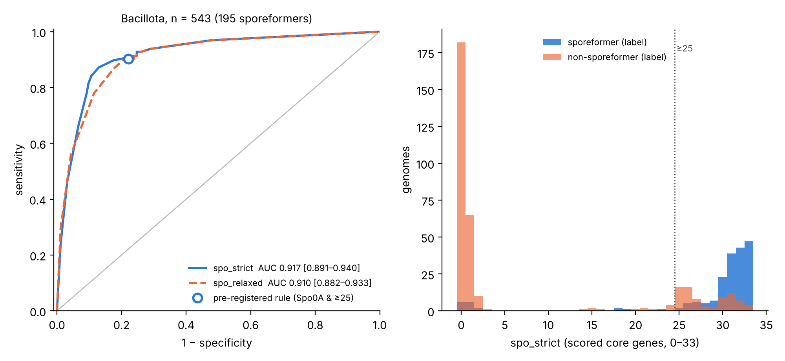

# Calibration of the genome-based sporulation call against phenotype labels

This is a **validation** of the pre-registered rule *sporulator = Spo0A present AND spo_strict ≥ 25/33*.
Nothing in `dictionary/` or the thresholds was changed. All scores come from the unchanged
`scripts/03_fetch_and_call_genes.py`, `scripts/05_hmm_search.py` and
`scripts/08_aggregate_modules.py`, run by `validation/02_run_pipeline.sh`. All numbers below are
produced by `validation/03_calibrate_sporulation.py`. They can be read in
`calibration_metrics.tsv`, `lineage_breakdown.tsv`, `misclassified.tsv`, `gene_missingness.tsv`,
`per_genome_scores.tsv` and `calibration_numbers.json`.

## 1. Labels

| Set | Genomes | Source of the label | Role |
|---|---|---|---|
| calibration | 543 Bacillota (195 sporeformers, 348 non-sporeformers) | Madin et al. 2020, *Sci Data* 7:170, doi:10.1038/s41597-020-0497-4 | primary ROC and confusion matrices |
| specificity | 71 non-Bacillota (Pseudomonadota, Actinomycetota, Bacteroidota, Cyanobacteria and others), all labelled non-sporulating | same | expected score 0 |
| qc_nonendospore | 12 non-Bacillota labelled sporulating (11 actinomycete exospore formers, 1 *Gracilimonas*) | same | the endospore rule should **not** fire |
| browne_experimental | 5 Erysipelotrichia | Browne et al. 2021, *Genome Biol* 22:204, doi:10.1186/s13059-021-02428-6, Table S1, ethanol-resistance assay | experimental label only |

**How the Madin labels were built** (`01_build_labels.py`). Madin et al. compile phenotypes from five
sources: IJSEM species descriptions (the `fierer` source), GOLD, PATRIC, the Microbe Directory and
ProTraits.
- A species gets a label only if at least one of the four curated sources reports sporulation and
  every source, ProTraits included, agrees. ProTraits partly predicts traits from genomes, so it can
  cancel a label but never create one.
- 330 labels are "tier A" (an IJSEM description is among the sources). The other 213 are "tier B".
- Species were sampled with a fixed seed, at most 70 per (order × label). Each species was then
  mapped to an NCBI RefSeq assembly, preferring type material and then the highest assembly level.
  91 % of the assemblies are type material. 37 % are complete or chromosome-level.

**Sources that could not be used**
- **Galperin et al. 2022 Table S1 (doi:10.1128/jb.00079-22): not reachable.** Europe PMC reports the
  article as not open access. PMC serves the supplementary file only behind a browser challenge, and
  I did not try to get around it. This source is still missing. It would be the most directly
  comparable label set, because the dictionary's core genes come from that paper's Table 1, not its
  Table S1.
- **Browne et al. 2021.** Only 41 isolates have an experimental (ethanol-resistance) label, and only
  5 of those have an NCBI RefSeq assembly (all ethanol-negative Erysipelotrichia). The paper's
  1,358-genome "spore-former characterisation" column is a genome-signature prediction. Following
  the replication plan, it was **not** used as truth.
- **BacDive** needs registration; it was not used separately. Madin et al. already include BacDive
  for some traits, but the sporulation field comes from the five sources above.

## 2. ROC and AUC (calibration set, n = 543)

| Score | AUC | 95 % CI (2,000 bootstrap resamples) | Youden-optimal threshold | Youden J |
|---|---|---|---|---|
| `spo_strict` | **0.917** | 0.891–0.940 | ≥ 27 (same with or without the Spo0A requirement) | 0.742 |
| `spo_relaxed` | 0.910 | 0.882–0.933 | ≥ 29 | 0.693 |

The relaxed score does not improve discrimination. It rescues some genes in true sporeformers
(see §5), but it also raises the scores of label-negative genomes.

## 3. Confusion matrices for the pre-registered rule and its alternatives

| Rule | TP | FN | FP | TN | Sensitivity | Specificity | Precision | MCC |
|---|---|---|---|---|---|---|---|---|
| **Spo0A & ≥ 25 (pre-registered)** | 176 | 19 | 77 | 271 | **0.903** [0.857–0.942] | **0.779** [0.735–0.822] | 0.696 [0.637–0.752] | **0.655** [0.594–0.713] |
| Spo0A & ≥ 17 | 180 | 15 | 86 | 262 | 0.923 | 0.753 | 0.677 | 0.649 |
| Spo0A & ≥ 20 | 177 | 18 | 86 | 262 | 0.908 | 0.753 | 0.673 | 0.634 |
| Spo0A & ≥ 27 | 169 | 26 | 45 | 303 | 0.867 | 0.871 | 0.790 | 0.724 |
| Spo0A only | 182 | 13 | 112 | 236 | 0.933 | 0.678 | 0.619 | 0.589 |
| Spo0A & relaxed ≥ 25 | 177 | 18 | 83 | 265 | 0.908 | 0.761 | 0.681 | 0.643 |

Brackets are 95 % bootstrap CIs; the CIs for every rule are in `calibration_metrics.tsv`.

**Sensitivity analysis on label quality.** These subsets were chosen before looking at the errors.
No genome was removed from the primary metrics above.

| Subset | n | AUC (95 % CI) | Sensitivity | Specificity | MCC |
|---|---|---|---|---|---|
| ≥ 2 curated sources agree | 293 | 0.964 (0.945–0.980) | 0.944 | 0.786 | 0.723 |
| tier A (IJSEM description present) | 330 | 0.911 (0.878–0.940) | 0.922 | 0.751 | 0.668 |
| complete or chromosome assemblies only | 203 | 0.929 (0.888–0.963) | 0.897 | 0.752 | 0.591 |

AUC rises to 0.96 when two independent curated sources agree on the label. This fits the reading
that a good part of the remaining error lies in the labels rather than in the genome call (§5).

## 4. Results by lineage (pre-registered rule)

| Lineage | n | Sporeformers / others | AUC (`spo_strict`) | TP | FN | FP | TN | Sensitivity | Specificity | MCC |
|---|---|---|---|---|---|---|---|---|---|---|
| Bacillaceae | 59 | 44 / 15 | 0.869 | 43 | 1 | 6 | 9 | 0.977 | 0.600 | 0.670 |
| Paenibacillaceae | 21 | 21 / 0 | – | 20 | 1 | 0 | 0 | 0.952 | – | – |
| other Bacillales | 60 | 5 / 55 | 0.969 | 5 | 0 | 5 | 50 | 1.000 | 0.909 | 0.674 |
| Clostridia | 191 | 98 / 93 | 0.793 | 91 | 7 | 64 | 29 | 0.929 | **0.312** | 0.307 |
| Tissierellia | 23 | 9 / 14 | 0.833 | 5 | 4 | 0 | 14 | 0.556 | 1.000 | 0.657 |
| Erysipelotrichia | 16 | 3 / 13 | 0.923 | 0 | 3 | 1 | 12 | **0.000** | 0.923 | −0.124 |
| Negativicutes | 54 | 12 / 42 | 0.978 | 12 | 0 | 1 | 41 | 1.000 | 0.976 | 0.949 |
| Lactobacillales | 73 | 3 / 70 | 0.493 | 0 | 3 | 0 | 70 | 0.000 | 1.000 | – |
| Mollicutes | 46 | 0 / 46 | – | 0 | 0 | 0 | 46 | – | 1.000 | – |

The three Lactobacillales labelled "sporulating" all score 0 and lack Spo0A (see §5). The lineage
AUC of 0.49 therefore reflects those labels, not a property of the score. "Clostridia" follows the
NCBI class used by Madin et al. (Clostridiales, Thermoanaerobacterales, Halanaerobiales and
Natranaerobiales).

### Other sets

- **Non-Bacillota specificity set (71 genomes): every `spo_strict` is 0 and none has Spo0A**, so
  there is no false positive outside Bacillota. This repeats the reference check in
  `results/phase1_reference_validation.txt` on a larger, independent sample.
- **Non-endospore "sporulators" (12 genomes): every score is 0.** The rule does not fire on
  actinomycete exospores, as intended. This also confirms a limitation listed in
  `dictionary/README.md`: these dormancy forms are not covered.
- **Browne 2021 ethanol-negative Erysipelotrichia (5 genomes): all 5 called non-sporulators.**
  *Thomasclavelia* (*Erysipeloclostridium*) *ramosa* DSM 1402 scores 19 with Spo0A ("reduced"
  class) and *Holdemania massiliensis* AP2 scores 15 with Spo0A. The other three score 0–1 without
  Spo0A. Note that Browne et al. themselves describe *T. ramosa* as a spore-former despite the
  negative ethanol test (their Table S3). The ethanol assay is therefore a weak negative label for
  this class.

## 5. Every misclassified genome

All 96 errors (19 FN, 77 FP), with the scored genes each is missing, are in `misclassified.tsv`.
Its columns are `missing_strict`, `rescued_by_pass_nc` (genes the relaxed score would add),
`below_cutoff_hits` (best score / cutoff of the gene's model) and `sigK_fragments`. The patterns
are summarised below.

### False negatives (labelled sporeformer, called non-sporulator): 19

| Pattern | Genomes | Interpretation |
|---|---|---|
| Spo0A present, score 18–19, missing the forespore/mother-cell sigma cascade (spoIIE, sigE, sigF, sigG, spoIIAA, spoIIGA, spoIIIAC/AE/AG, spoIIR, spoIIID, spoVT …) | *Thomasclavelia ramosa*, *T. spiroformis* DSM 1552, *T. cocleata* | Erysipelotrichia. This is exactly the pattern Galperin 2022 describes for spore-forming Erysipelotrichia, and `dictionary/README.md` already lists it as a known limitation. The relaxed score adds only 1–3 genes (spoIIE, sigE and ytaF score below TC, e.g. SpoIIE 213/491). |
| Spo0A missing, score 28 (30 relaxed) | *Thermanaeromonas toyohensis* ToBE | Spo0A, spoIIE, spoIIQ, sigK and yabP are not called. spoIIE scores 382/491 and yabP 73/75 (both below TC). No Spo0A hit passes. Possibly a divergent Spo0A, or an assembly gap; **not verified**. |
| Spo0A present, score 23 (25 relaxed) | *Cellulosilyticum ruminicola* JCM 14822 | spoIIE scores 473/491 and ylbJ 232/305; with the relaxed score it would just pass (25). The split-sigK check found sub-threshold SigK-model hits on 3 proteins. |
| Score 0–2, no or isolated sporulation genes | *Alkalicoccus chagannorensis*, *Saccharibacillus kuerlensis* (Spo0A only); *Proteocatella sphenisci*, *Lachnoanaerobaculum orale* and *L. umeaense*, *Peptostreptococcus stomatis*, *Acetoanaerobium sticklandii*, *Soehngenia saccharolytica* (1 gene); *Enterococcus termitis*, *E. silesiacus*, *Liquorilactobacillus hordei*, *Anaerosphaera aminiphila*, *Peptoniphilus grossensis*, *P. senegalensis* (0 genes) | Genomes with ≤ 2 of 33 core genes almost certainly cannot make endospores. Most of these are **probable label errors**. Enterococci, lactobacilli and *Peptoniphilus* are not known to sporulate, and 8 of the 14 rest on a single source. *A. chagannorensis* and *S. kuerlensis* are labelled by three sources but keep only Spo0A and SpoVB. The labels were **not** changed; these genomes stay in every metric above. |

**The skin element and split sigK.** sigK is missing in 46 of 195 label-positive genomes (strict
score), and the relaxed score does not recover any of them. Among the false negatives with a
non-trivial score, *Cellulosilyticum* (3) and *Thermanaeromonas* (9) carry several sub-threshold
SigK-model hits. That is consistent with a fragmented or interrupted sigK, but the column counts
every sub-threshold SigK-model protein, including other sigma factors, so it is not proof. In 4 of
the 19 FNs, adding a single gene would not change the call, because each misses more than one gene
or lacks Spo0A. sigK splitting is therefore **not** the main cause of the false negatives here.

**Most often missing core genes in label-positive genomes** (`gene_missingness.tsv`):
- spoIIQ: 123 of 195. Clostridial SpoIIQ is divergent; this is the known model-sensitivity problem.
- ytaF: 65 (39 with the relaxed score).
- sigK: 46.
- spoIIE: 45 (15 relaxed).
- sigF: 44.
- spoVV/ylbJ: 43 (21 relaxed).

spoIIQ alone accounts for one point of the score in most clostridia, which is why their median
score among sporeformers is 31 rather than 33.

### False positives (labelled non-sporeformer, called sporulator): 77

64 of the 77 are Clostridia. 32 have `spo_strict` ≥ 30, i.e. an essentially complete core
sporulation gene set. They fall into four groups:

- **Gut Lachnospiraceae/Ruminococcaceae/Oscillospiraceae and *Turicibacter* (28 genomes, scores
  25–27).**
  - Genera include *Blautia*, *Dorea*, *Roseburia*, *Anaerostipes*, *Coprococcus*,
    *Mediterraneibacter*, *Fusicatenibacter*, *Ruminococcus*, *Anaerotruncus* and *Butyricicoccus*.
  - Under strict cutoffs they typically lack spoIIE, sigF/sigG, spoIID, spoIIQ, ytaF and ylbJ. The
    relaxed score adds 2–5 points.
  - These labels are weak. Browne et al. 2016 (*Nature* 533:543, doi:10.1038/nature17645) found
    sporulation to be widespread among gut bacteria cultured after ethanol treatment. Browne et
    al. 2021 Table S1 classifies 82 % of 307 Lachnospiraceae genomes and 97 % of 104
    Ruminococcaceae genomes as spore-formers, but that classification is their genome-signature
    prediction, not an assay.
  - At species level, *Ruminococcus bromii*, labelled "no" by three sources here, was shown to
    sporulate by Mukhopadhya et al. 2018 (*Environ Microbiol*, doi:10.1111/1462-2920.14000).
  - So this group mixes label errors (sporulation never tested under the right conditions) with
    possible recent, partial losses of sporulation. Neither the genome rule nor these labels can
    separate the two.
- **Thermophilic, halophilic and syntrophic anaerobes (33 genomes, scores 27–32).**
  - Genera include *Thermoanaerobacterium*, *Caldanaerobius*, *Thermovenabulum*, *Syntrophomonas*,
    *Syntrophothermus*, *Thermosyntropha*, *Caloramator*, *Natranaerobius*, *Halobacteroides*,
    *Thermaerobacter*, *Symbiobacterium* and *Ammonifex*.
  - Most miss only spoIIQ, sometimes also sigF or ytaF, and have Spo0A.
  - In comparison, *Syntrophomonas wolfei* Göttingen scores 30 in the project's reference check,
    and the subspecies name *S. erecta* subsp. *sporosyntropha* refers to spore formation.
  - With a near-complete gene set, "non-sporulating" here most likely means "spores not observed in
    culture". This is **not verified** per species.
- ***Caldicellulosiruptor* (5 genomes, all scoring 25).** The genus is described as
  non-spore-forming yet keeps about 25/33 core genes. These are credible genuine false positives
  at the 25 threshold; the ≥ 27 rule would call them correctly.
- **Bacillales (11 genomes).**
  - 4 Bacillaceae score 33/33 (*Halalkalibacter okhensis*, *Aquisalibacillus elongatus*,
    *Salibacterium qingdaonense*, *Geomicrobium halophilum*) and 2 *Calditerricola* score 32. A
    complete gene set labelled "non-sporulating" is most likely a label or culture-condition issue.
  - 4 *Bhargavaea* (Planococcaceae, 25–26) and *Halolactibacillus miurensis* (26) miss the
    forespore sigma cascade (sigE, sigF, sigG, spoIIE). These look like genuine partial losses
    sitting just above the threshold.

Altogether, most of the 77 false positives (the gut group, the thermophile/syntroph group and the
33/33 Bacillaceae) are plausibly wrong or ambiguous labels rather than wrong genome calls. The 5
*Caldicellulosiruptor* and the 5 *Bhargavaea*/*Halolactibacillus* genomes look like genuine errors
of the 25 threshold. I cannot settle the rest without phenotype experiments. Following the honesty
rules, **all 77 are counted as errors** in §3.

## 6. Is the pre-registered threshold supported?

- **Discrimination is good.** AUC is 0.92 overall and 0.96 when the label is backed by two sources.
  No genome outside Bacillota gets a non-zero score.
- **The pre-registered rule sits at the high-sensitivity end** of the ROC: sensitivity 0.90,
  specificity 0.78. The data-driven Youden optimum is ≥ 27 rather than ≥ 25. That gives a better
  MCC (0.72 vs 0.66) by trading 7 TPs for 32 fewer FPs, mostly the gut clostridia, *Caldicellulosiruptor* and
  *Bhargavaea* scoring 25–26.
- **The rule is not changed.** This calibration was run after the threshold was pre-registered,
  so ≥ 27 is a post-hoc optimum on noisy labels. Per the replication plan it is reported, not adopted. The
  pre-registered plan already includes sensitivity analyses at 60 % and 80 % (≥ 20 and ≥ 27), so
  this result belongs in that sensitivity analysis.
- **What the main analysis should keep in mind:**
  1. Specificity is lowest in Clostridia (0.31), where "non-sporulating" labels are least reliable
     and gene loss is most often partial.
  2. The rule misses spore-forming Erysipelotrichia (0/3 here). This was predicted in
     `dictionary/README.md`, and they fall in the "reduced" class (17–24).
  3. The continuous `spo_strict` score is better behaved than any single cut. The 25–27 band holds
     most of the ambiguous genomes.

## 7. Limitations

- **Labels are species-level phenotypes from compiled databases**, matched to one assembly per
  species, usually the type strain. They are not strain-matched experimental results. Label noise is
  real and asymmetric: "spores not observed" is often recorded as "non-sporulating".
- **The Galperin 2022 and full Browne 2021 experimental label sets were unavailable** (§1). The
  only experimental labels used are 5 ethanol-negative Erysipelotrichia.
- **Sampling is stratified by order and capped**, so lineage proportions do not represent Bacillota
  as a whole. Clostridia and Bacillales dominate the sporeformers, and Lactobacillales and Mollicutes
  dominate the non-sporeformers.
- **63 % of assemblies are scaffold- or contig-level.** Restricting to complete or chromosome
  assemblies gives a similar AUC (0.93) but lower MCC (0.59), because that subset happens to hold
  more of the thermophile false positives.
- **The split-sigK check is a heuristic** and counts other sigma factors too.
- **The bootstrap CIs resample genomes, not lineages.** Genomes are phylogenetically clustered, so
  the CIs are somewhat too narrow.
